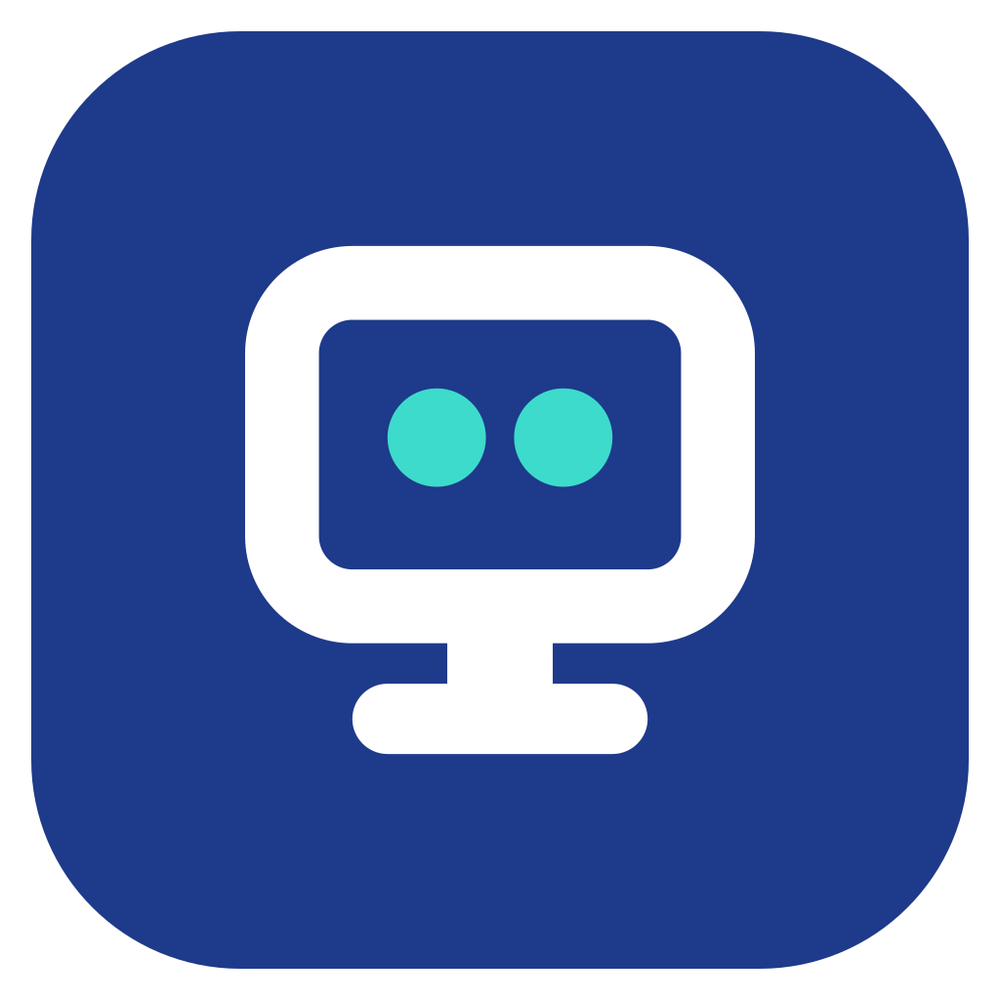
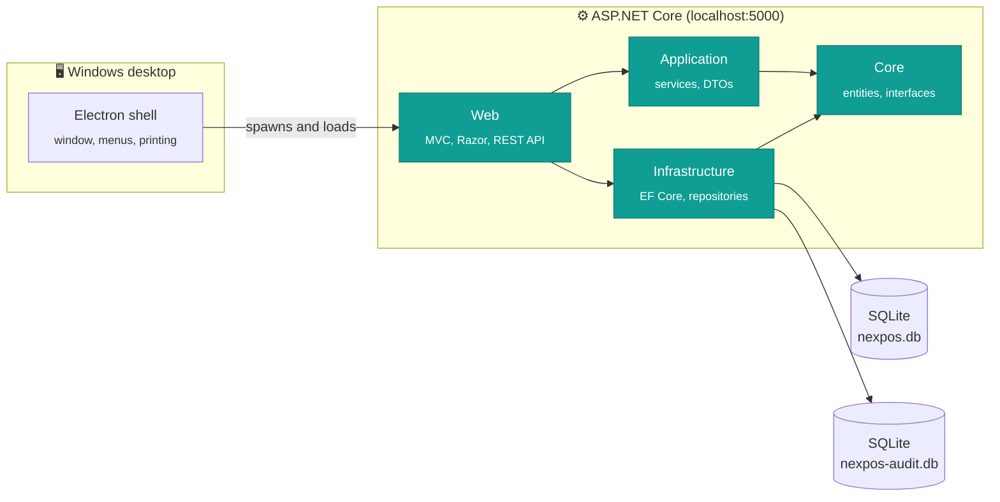

<div align="center">



# Coduo POS

**A fast, offline-first point of sale and back-office for retail shops.**
Sell at the till, track stock and debts, close the shift, and see the numbers, in English or Arabic.

<br />


[Features](#-features) ·
[Architecture](#-architecture) ·
[Getting started](#-getting-started) ·
[Build the installer](#-build-the-installer) ·
[Licensing](#-licensing) ·
[Docs](#-documentation)

</div>

<br />

> [!NOTE]
> Coduo POS ships as a single Windows installer. There is no database server to set up and no internet needed to run it: the app, its SQLite database and its license check all live on the shop's own PC.

---

## ✨ Features

<table>
<tr>
<td width="50%" valign="top">

### 🛒 Point of sale
- Fast till with product search-as-you-type and a configurable main screen
- Hold and resume carts, discounts
- Multiple payment methods
- Thermal receipt printing (ESC/POS) and cash drawer support
- Idempotent checkout, so a double-click never rings a sale twice
- Sale reversal for refunds and corrections

</td>
<td width="50%" valign="top">

### 📦 Inventory
- Products, categories, units and tax rates
- Bulk import and export of the catalogue
- Live stock deduction on every sale
- Low-stock alerts and notifications
- Custom display order for the till screen

</td>
</tr>
<tr>
<td width="50%" valign="top">

### 💰 Money and debts
- Customer debt ledger with payments and balance history
- Supplier debt tracking
- Multi-currency with managed exchange rates
- Cash drawer shifts with opening, closing and reconciliation

</td>
<td width="50%" valign="top">

### 📊 Reports and insight
- Dashboard with the day's key numbers
- Sales reports with export
- Orders history with status workflow
- Printable reports and receipts

</td>
</tr>
<tr>
<td width="50%" valign="top">

### 🔐 Security and control
- Cashier PIN sign-in, role-based permissions
- Full **audit trail** (who did what, when, from where) in its own database
- JWT auth, request rate limiting, input validation
- Automatic and manual **backups** with restore

</td>
<td width="50%" valign="top">

### 🌍 Built for the real world
- English and Arabic UI with full right-to-left layout
- Runs fully offline
- Offline license keys bound to one PC
- Packaged as a one-click Windows installer or portable EXE

</td>
</tr>
</table>

---

## 🧱 Architecture

A layered .NET solution with a thin Electron shell around it. Electron starts the ASP.NET Core app on `localhost:5000` and shows it in a native window.



| Project | Responsibility |
|---|---|
| [`Core`](Core) | Entities, enums, repository and printing interfaces, time handling. No dependencies on anything else. |
| [`Application`](Application) | Business services (checkout, cash drawer, debts, reports, backups, licensing), DTOs, exceptions. |
| [`Infrastructure`](Infrastructure) | EF Core `DbContext`, migrations, repositories, audit interceptor, licensing storage, caching. |
| [`Web`](Web) | MVC controllers and Razor views, JWT/PIN auth, middleware, localization (`.resx`), static assets. |
| [`Common`](Common) | Shared helpers, results, mapping and the license codec. |
| [`Tests`](Tests) | xUnit suite: services, repositories, migrations, audit trail and licensing. |
| [`tools`](tools) | `LicenseIssuer`, `LicenseKeygen`, `ClearSales` and the `demo-video` recorder. |

### Tech stack

| Layer | Technology |
|---|---|
| Backend | .NET 9, ASP.NET Core MVC, EF Core 9 |
| Data | SQLite (data file and audit file kept separate) |
| Auth and safety | JWT, BCrypt, FluentValidation, AspNetCoreRateLimit |
| Logging and API docs | Serilog, Swagger (Swashbuckle) |
| Printing and imaging | SkiaSharp, ESC/POS thermal output |
| Front end | Razor, jQuery, Bootstrap, DataTables, Select2, SweetAlert2 (no build step) |
| Desktop | Electron 30, electron-builder (NSIS installer and portable) |
| Testing | xUnit, Moq, in-memory SQLite |

---

## 🚀 Getting started

### Prerequisites

| Tool | Version |
|---|---|
| [.NET SDK](https://dotnet.microsoft.com/download) | 9.0 |
| [Node.js](https://nodejs.org/) | LTS (for the Electron shell) |
| OS | Windows 10 or 11 |

### Run it

```powershell
git clone https://github.com/alaaredamq/ERP.git
cd ERP
```

**Web only** (browser at <http://localhost:5000>):

```powershell
dotnet run --project Web
```

**As the desktop app** (Electron starts the backend for you):

```powershell
npm install
npm run dev
```

On first launch the database is created automatically at `%LocalAppData%\NexPOS\nexpos.db`. Debug builds never ask for a license key.

### Run the tests

```powershell
dotnet test
```

---

## 📦 Build the installer

```powershell
npm install
.\build-electron.ps1 win-installer
```

| Target | Result |
|---|---|
| `win-installer` | NSIS installer, recommended for customers |
| `win-portable` | Single portable EXE, no install |
| `win` | Both |

Output lands in `dist/`. The script publishes the .NET app to `publish/app` first, then packages it with Electron.

<details>
<summary><b>Manual steps</b></summary>

<br />

```powershell
dotnet publish Web\Web.csproj -c Release -o publish\app
npm run build:win-installer
```

See [`BUILD_NEW_INSTALLER.md`](BUILD_NEW_INSTALLER.md) and [`ELECTRON_SETUP_GUIDE.md`](ELECTRON_SETUP_GUIDE.md) for troubleshooting.

</details>

---

## 🔑 Licensing

Release builds need an **offline license key** tied to one PC. Every customer gets every feature; the key only decides whether the till may sell.

| Key | Meaning | When the date passes |
|---|---|---|
| **Full** | Date is the end of the updates plan | The till never expires; newer builds refuse to run |
| **Provisional** | Expiry date, for instalment sales | 7-day grace, then selling stops |
| **Trial** | Expiry date, for evaluations | 7-day grace, then selling stops |

Even when selling is stopped, products, orders, reports, backups and settings keep working. Customer data is never touched.

Issue a key from a customer's Machine ID:

```powershell
dotnet run --project tools/LicenseIssuer -- issue --machine <ID> --customer "<name>" --kind full
```

Full details in [`LICENSING.md`](LICENSING.md).

---

## 🗂️ Repository layout

```text
ERP/
├── Core/              Entities, enums, interfaces
├── Application/       Services, DTOs, business rules
├── Infrastructure/    EF Core, migrations, repositories
├── Web/               MVC app, views, API, localization
├── Common/            Shared helpers and license codec
├── Tests/             xUnit test suite
├── tools/             License issuer, key tools, demo recorder
├── electron-main.js   Desktop shell
├── build-electron.ps1 One-command Windows build
└── ERP.sln
```

---

## 📚 Documentation

| Doc | What's in it |
|---|---|
| [`LICENSING.md`](LICENSING.md) | License key kinds, expiry timeline, issuing and renewing keys |
| [`BUILD_NEW_INSTALLER.md`](BUILD_NEW_INSTALLER.md) | Cutting a new installer for release |
| [`ELECTRON_SETUP_GUIDE.md`](ELECTRON_SETUP_GUIDE.md) | Electron packaging walkthrough |
| [`QUICK_START_ELECTRON.md`](QUICK_START_ELECTRON.md) | Three-command build cheat sheet |
| [`WORKLOG.md`](WORKLOG.md) | Running engineering log, backlog and decisions |
| [`TESTER_FINDINGS.md`](TESTER_FINDINGS.md) | Findings from the latest tester pass |
| [`tools/demo-video`](tools/demo-video/README.md) | Record the client walkthrough video |

---

<div align="center">

Built by [**@alaaredamq**](https://github.com/alaaredamq) 

<sub>Coduo POS · .NET 9 · Electron · SQLite</sub>

</div>
